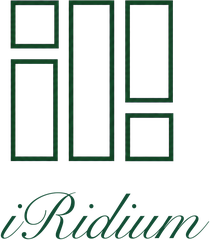
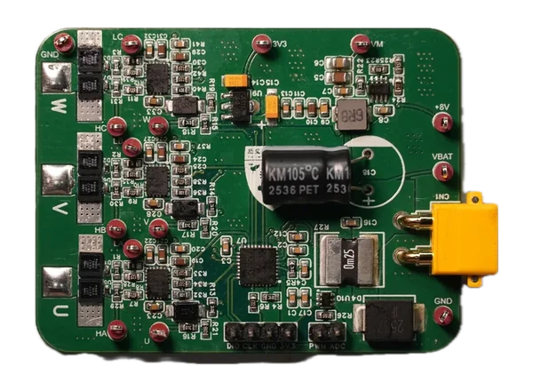
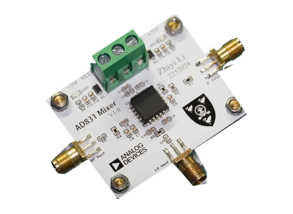
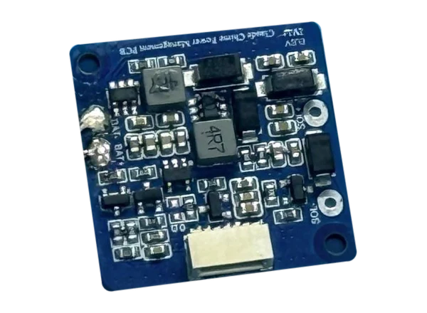
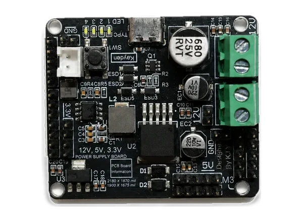

<!--
  Awes0meE 个人主页 README
  ✏️ 标记的地方是可以改的文案。这种注释块在 GitHub 上不会显示。
  示波器上的文字改 tools/scope.py，技术栈（含鼠标悬停说明）改 tools/tech_stack.py，改完运行对应脚本重新生成。
-->

<!-- ✏️ 顶部横幅：text= 是大字，desc= 是小字。空格写 %20，× 写 %C3%97，· 写 %C2%B7，/ 写 %2F。深色、浅色、兜底三条要改成一样 -->
<a href="https://www.66ccff-labs.com">
  <picture>
    <source media="(prefers-color-scheme: dark)" srcset="https://capsule-render.vercel.app/api?type=waving&color=0:080808%2C55:11110F%2C100:FF7400&height=220&section=header&text=Alvin%20Li&fontColor=FAFAFA&fontSize=64&fontAlignY=36&animation=fadeIn&desc=Robotics%20%C3%97%20Full-stack%20%C2%B7%20iRidium%20Lab&descAlignY=58&descSize=18">
    <source media="(prefers-color-scheme: light)" srcset="https://capsule-render.vercel.app/api?type=waving&color=0:FFFFFF%2C60:DBEAFE%2C100:2563EB&height=220&section=header&text=Alvin%20Li&fontColor=1E3A8A&fontSize=64&fontAlignY=36&animation=fadeIn&desc=Robotics%20%C3%97%20Full-stack%20%C2%B7%20iRidium%20Lab&descAlignY=58&descSize=18">
    
  </picture>
</a>

  <a href="https://www.66ccff-labs.com">
    <picture>
      <source media="(prefers-color-scheme: dark)" srcset="assets/brand/iridium-lockup-dark.png">
      <source media="(prefers-color-scheme: light)" srcset="assets/brand/iridium-lockup-light.png">
      
    </picture>
  </a>

<!--
  ✏️ 一直在变的那行蓝色英文字（打字动画）。只改 lines= 后面那一段：
     - 每一行之间用英文分号 ; 隔开
     - 空格写成 +
     - 特殊字符必须转义，不然 GitHub 会显示成裂图：
         × → %C3%97    · → %C2%B7    + → %2B    & → %26    # → %23    , → %2C
     - 纯英文字母、数字、- / . 可以直接写
  现在这 3 行是：
     Robotics × Full-stack engineer
     MCU · PCB · Control · Sensor Fusion
     Tauri + Rust + React desktop tools
  颜色改 color=（6 位十六进制，不带 #），速度改 pause=（每行停留毫秒）。
-->

  
   
  <!-- ✏️ 打字动画下面那行中文小字 -->
  机器人系统硬件 · 嵌入式 · 姿态控制 · 传感器融合 &nbsp;|&nbsp; 硬件为主，软件随行

<!-- ✏️ 两个徽章：badge/ 后面是「左边文字-右边文字-颜色」。文字里空格写 _，减号写 --，下划线写 __ -->

  
  

<!-- 示波器：图上文字改 tools/scope.py。改了通道名的话，下面  里的通道名也要手动改 -->

  <picture>
    <source media="(prefers-color-scheme: dark)" srcset="assets/svg/scope-dark.svg">
    <source media="(prefers-color-scheme: light)" srcset="assets/svg/scope-light.svg">
    
  </picture>

## About

<!-- ✏️ 自我介绍 -->
Robotic-systems hardware and embedded engineer. I work from schematic and PCB layout through MCU firmware, and I write the desktop and web software my hardware needs.

## Hardware

<!-- ✏️ 每张卡片：<b> 里是标题， 里是说明。板子图片在 assets/boards/ -->
<table>
  <tr>
    <td align="center" width="33%" valign="top">
      
       <b>GaN Quadrotor ESC</b>
       GaN FETs + LMG1210 driver, 5 board spins
    </td>
    <td align="center" width="33%" valign="top">
      
       <b>AD831 Active Mixer</b>
       120 MHz RF → 10.7 MHz IF, 4 revisions
    </td>
    <td align="center" width="33%" valign="top">
      
       <b>Claude Chime Power Board</b>
       ESP32 power board for Accele AI, 28 × 27 mm
    </td>
  </tr>
  <tr></tr>
  <tr>
    <td align="center" width="33%" valign="top">
      
       <b>Cirro Cooling Controllers</b>
       STM32 boards for phase-change cooling
    </td>
    <td align="center" width="33%" valign="top">
      
       <b>Course Project Tool Boards</b>
       Buck, USB PD multi-rail, charge-and-boost
    </td>
    <td align="center" width="33%" valign="top">
      <!-- 这张还没有作品集页面，先不加链接；套在 picture 里是为了让 GitHub 不把图片变成可点开的大图 -->
      <picture></picture>
       <b>Wireless Voice-Controlled Light</b>
       ASRPRO voice recognition + OLED controller
    </td>
  </tr>
</table>

<a href="https://www.66ccff-labs.com/work">→ all projects on 66ccff-labs.com/work</a>

## Tech stack

<!-- ✏️ 技术栈三行（语言 / 嵌入式与硬件 / 软件与工具）和鼠标悬停时浮出的说明，都在 tools/tech_stack.py 的 ROWS 里改，改完运行 python tools/tech_stack.py -->
<!-- tech-stack:start：这一段由 tools/tech_stack.py 自动生成，不要手改；改图标或悬停说明请改那个脚本里的 ROWS -->

<picture><source media="(prefers-color-scheme: dark)" srcset="assets/svg/stack/c-dark.svg"></picture><picture><source media="(prefers-color-scheme: dark)" srcset="assets/svg/stack/cpp-dark.svg"></picture><picture><source media="(prefers-color-scheme: dark)" srcset="assets/svg/stack/python-dark.svg"></picture><picture><source media="(prefers-color-scheme: dark)" srcset="assets/svg/stack/rust-dark.svg"></picture><picture><source media="(prefers-color-scheme: dark)" srcset="assets/svg/stack/verilog-dark.svg"></picture><picture><source media="(prefers-color-scheme: dark)" srcset="assets/svg/stack/matlab-dark.svg"></picture><picture><source media="(prefers-color-scheme: dark)" srcset="assets/svg/stack/cmake-dark.svg"></picture><picture><source media="(prefers-color-scheme: dark)" srcset="assets/svg/stack/bash-dark.svg"></picture><picture><source media="(prefers-color-scheme: dark)" srcset="assets/svg/stack/powershell-dark.svg"></picture><picture><source media="(prefers-color-scheme: dark)" srcset="assets/svg/stack/latex-dark.svg"></picture><picture><source media="(prefers-color-scheme: dark)" srcset="assets/svg/stack/md-dark.svg"></picture> 
<picture><source media="(prefers-color-scheme: dark)" srcset="assets/svg/stack/stmicroelectronics-blue-white-dark.svg"></picture><picture><source media="(prefers-color-scheme: dark)" srcset="assets/svg/stack/texas-instruments-symbol-transparent-dark.svg"></picture><picture><source media="(prefers-color-scheme: dark)" srcset="assets/svg/stack/adi-dark.svg"></picture><picture><source media="(prefers-color-scheme: dark)" srcset="assets/svg/stack/espressif-symbol-dark.svg"></picture><picture><source media="(prefers-color-scheme: dark)" srcset="assets/svg/stack/artery-wordmark-dark.svg"></picture><picture><source media="(prefers-color-scheme: dark)" srcset="assets/svg/stack/arduino-dark.svg"></picture><picture><source media="(prefers-color-scheme: dark)" srcset="assets/svg/stack/keil-uvision-dark.svg"></picture><picture><source media="(prefers-color-scheme: dark)" srcset="assets/svg/stack/lvgl-dark.svg"></picture><picture><source media="(prefers-color-scheme: dark)" srcset="assets/svg/stack/altium-designer-dark.svg"></picture><picture><source media="(prefers-color-scheme: dark)" srcset="assets/svg/stack/cadence-pcb-editor-clean-dark.svg"></picture><picture><source media="(prefers-color-scheme: dark)" srcset="assets/svg/stack/kicad-logo-dark.svg"></picture><picture><source media="(prefers-color-scheme: dark)" srcset="assets/svg/stack/easyeda-dark.svg"></picture><picture><source media="(prefers-color-scheme: dark)" srcset="assets/svg/stack/solidworks-user-drawn-transparent-dark.svg"></picture> 
<picture><source media="(prefers-color-scheme: dark)" srcset="assets/svg/stack/ts-dark.svg"></picture><picture><source media="(prefers-color-scheme: dark)" srcset="assets/svg/stack/js-dark.svg"></picture><picture><source media="(prefers-color-scheme: dark)" srcset="assets/svg/stack/html-dark.svg"></picture><picture><source media="(prefers-color-scheme: dark)" srcset="assets/svg/stack/css-dark.svg"></picture><picture><source media="(prefers-color-scheme: dark)" srcset="assets/svg/stack/react-dark.svg"></picture><picture><source media="(prefers-color-scheme: dark)" srcset="assets/svg/stack/tauri-dark.svg"></picture><picture><source media="(prefers-color-scheme: dark)" srcset="assets/svg/stack/nodejs-dark.svg"></picture><picture><source media="(prefers-color-scheme: dark)" srcset="assets/svg/stack/vite-dark.svg"></picture><picture><source media="(prefers-color-scheme: dark)" srcset="assets/svg/stack/sqlite-dark.svg"></picture><picture><source media="(prefers-color-scheme: dark)" srcset="assets/svg/stack/qt-dark.svg"></picture><picture><source media="(prefers-color-scheme: dark)" srcset="assets/svg/stack/linux-dark.svg"></picture><picture><source media="(prefers-color-scheme: dark)" srcset="assets/svg/stack/git-dark.svg"></picture>

<!-- tech-stack:end -->

## GitHub

  <picture>
    <source media="(prefers-color-scheme: dark)" srcset="https://github-stats-extended.vercel.app/api?username=Awes0meE&hide_rank=true&show_icons=true&hide_border=true&bg_color=11110F&title_color=FF7400&icon_color=66CCFF&text_color=FAFAFA&ring_color=66CCFF&hide=contribs&include_all_commits=false">
    <source media="(prefers-color-scheme: light)" srcset="https://github-stats-extended.vercel.app/api?username=Awes0meE&hide_rank=true&show_icons=true&bg_color=FFFFFF&title_color=2563EB&icon_color=38BDF8&text_color=1E3A8A&ring_color=2563EB&border_color=E5E7EB&hide=contribs&include_all_commits=false">
    
  </picture>
  <picture>
    <source media="(prefers-color-scheme: dark)" srcset="https://streak-stats.demolab.com/?user=Awes0meE&hide_border=true&background=11110F&ring=66CCFF&fire=FF7400&currStreakNum=FAFAFA&sideNums=FAFAFA&currStreakLabel=66CCFF&sideLabels=FAFAFA&dates=9A9A9A&stroke=333333">
    <source media="(prefers-color-scheme: light)" srcset="https://streak-stats.demolab.com/?user=Awes0meE&background=FFFFFF&ring=2563EB&fire=FF7400&currStreakNum=1E3A8A&sideNums=1E3A8A&currStreakLabel=2563EB&sideLabels=1E3A8A&dates=64748B&stroke=E5E7EB&border=E5E7EB">
    
  </picture>

<!-- 贪吃蛇：.github/workflows/snake.yml 每天和每次推送到 main 时重新生成到 output 分支。仓库 60 天没有动静时 GitHub 会暂停定时任务，到 Actions 页面重新启用即可 -->
<picture>
  <source media="(prefers-color-scheme: dark)" srcset="https://raw.githubusercontent.com/Awes0meE/Awes0meE/output/github-snake-dark.svg">
  <source media="(prefers-color-scheme: light)" srcset="https://raw.githubusercontent.com/Awes0meE/Awes0meE/output/github-snake.svg">
  
</picture>

<picture>
  <source media="(prefers-color-scheme: dark)" srcset="https://capsule-render.vercel.app/api?type=waving&color=0:080808%2C55:11110F%2C100:FF7400&height=120&section=footer">
  <source media="(prefers-color-scheme: light)" srcset="https://capsule-render.vercel.app/api?type=waving&color=0:FFFFFF%2C60:DBEAFE%2C100:2563EB&height=120&section=footer">
  
</picture>
