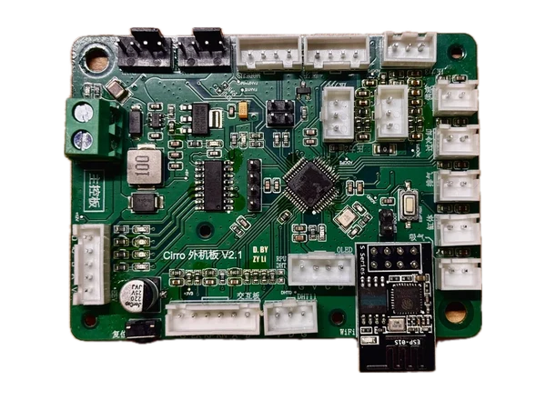
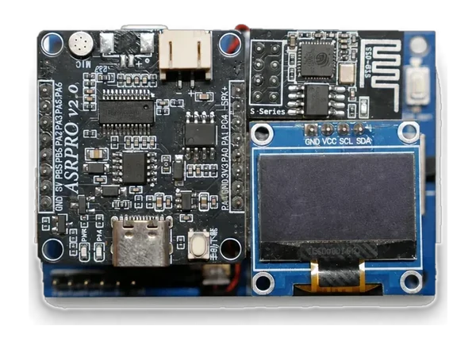

<!--
  Awes0meE 个人主页 README
  ✏️ 标记的地方是可以改的文案。这种注释块在 GitHub 上不会显示。
  示波器上的文字改 tools/scope.py，厂商 logo 那一行改 tools/vendor_logos.py，改完运行对应脚本重新生成图片。
-->

<!-- ✏️ 顶部横幅：text= 是大字，desc= 是小字。空格写 %20，× 写 %C3%97，· 写 %C2%B7，/ 写 %2F。深色、浅色、兜底三条要改成一样 -->
<a href="https://www.66ccff-labs.com">
  <picture>
    <source media="(prefers-color-scheme: dark)" srcset="https://capsule-render.vercel.app/api?type=waving&color=0:080808%2C55:11110F%2C100:FF7400&height=220&section=header&text=Alvin%20Li&fontColor=FAFAFA&fontSize=64&fontAlignY=36&animation=fadeIn&desc=Robotics%20%C3%97%20Full-stack%20%C2%B7%20iRidium%20Labs&descAlignY=58&descSize=18">
    <source media="(prefers-color-scheme: light)" srcset="https://capsule-render.vercel.app/api?type=waving&color=0:FFFFFF%2C60:DBEAFE%2C100:2563EB&height=220&section=header&text=Alvin%20Li&fontColor=1E3A8A&fontSize=64&fontAlignY=36&animation=fadeIn&desc=Robotics%20%C3%97%20Full-stack%20%C2%B7%20iRidium%20Labs&descAlignY=58&descSize=18">
    
  </picture>
</a>

  <a href="https://www.66ccff-labs.com">
    <picture>
      <source media="(prefers-color-scheme: dark)" srcset="assets/brand/iridium-lockup-dark.png">
      <source media="(prefers-color-scheme: light)" srcset="assets/brand/iridium-lockup-light.png">
      
    </picture>
  </a>

<!--
  ✏️ 一直在变的那行蓝色英文字（打字动画）。只改 lines= 后面那一段：
     - 每一行之间用英文分号 ; 隔开
     - 空格写成 +
     - 特殊字符必须转义，不然 GitHub 会显示成裂图：
         × → %C3%97    · → %C2%B7    + → %2B    & → %26    # → %23    , → %2C
     - 纯英文字母、数字、- / . 可以直接写
  现在这 3 行是：
     Robotics × Full-stack engineer
     MCU · PCB · Control · Sensor Fusion
     Tauri + Rust + React desktop tools
  颜色改 color=（6 位十六进制，不带 #），速度改 pause=（每行停留毫秒）。
-->

  
   
  <!-- ✏️ 打字动画下面那行中文小字 -->
  机器人系统硬件 · 嵌入式 · 姿态控制 · 传感器融合 &nbsp;|&nbsp; 硬件为主，软件随行

  
  

<!-- 示波器：图上文字改 tools/scope.py -->

  <picture>
    <source media="(prefers-color-scheme: dark)" srcset="assets/svg/scope-dark.svg">
    <source media="(prefers-color-scheme: light)" srcset="assets/svg/scope-light.svg">
    
  </picture>

## About

<!-- ✏️ 自我介绍 -->
Robotic-systems hardware and embedded engineer. I work from schematic and PCB layout through MCU firmware, and I write the desktop and web software my hardware needs.

## <kbd>CH1</kbd> Hardware

<!-- ✏️ 每张卡片：<b> 里是标题， 里是说明。板子图片在 assets/boards/ -->
<table>
  <tr>
    <td align="center" width="33%" valign="top">
      
       <b>GaN Quadrotor ESC</b>
       GaN FETs + LMG1210 driver, 5 board spins
    </td>
    <td align="center" width="33%" valign="top">
      
       <b>AD831 Active Mixer</b>
       120 MHz RF → 10.7 MHz IF, 4 revisions
    </td>
    <td align="center" width="33%" valign="top">
      
       <b>Claude Chime Power Board</b>
       ESP32 power board for Accele AI, 28 × 27 mm
    </td>
  </tr>
  <tr></tr>
  <tr>
    <td align="center" width="33%" valign="top">
      
       <b>Cirro Cooling Controllers</b>
       STM32 boards for phase-change cooling
    </td>
    <td align="center" width="33%" valign="top">
      
       <b>Course Project Tool Boards</b>
       Buck, USB PD multi-rail, charge-and-boost
    </td>
    <td align="center" width="33%" valign="top">
      
       <b>Wireless Voice-Controlled Light</b>
       ASRPRO voice recognition + OLED controller
    </td>
  </tr>
</table>

<a href="https://www.66ccff-labs.com/work">→ all projects on 66ccff-labs.com/work</a>

## <kbd>CH2</kbd> Firmware

<!-- 仓库卡片的标题和描述是 GitHub 自动读取的，要改就去改对应仓库的 About 描述 -->

  <a href="https://github.com/Awes0meE/STM32_Sensorless_FOC">
    <picture>
      <source media="(prefers-color-scheme: dark)" srcset="https://github-stats-extended.vercel.app/api/pin/?username=Awes0meE&repo=STM32_Sensorless_FOC&hide_border=true&bg_color=11110F&title_color=66CCFF&icon_color=FF7400&text_color=FAFAFA&description_lines_count=2">
      <source media="(prefers-color-scheme: light)" srcset="https://github-stats-extended.vercel.app/api/pin/?username=Awes0meE&repo=STM32_Sensorless_FOC&bg_color=FFFFFF&title_color=2563EB&icon_color=38BDF8&text_color=1E3A8A&border_color=E5E7EB&description_lines_count=2">
      
    </picture>
  </a>
  <a href="https://github.com/Awes0meE/STM32-BLDC-ESC-Experiments">
    <picture>
      <source media="(prefers-color-scheme: dark)" srcset="https://github-stats-extended.vercel.app/api/pin/?username=Awes0meE&repo=STM32-BLDC-ESC-Experiments&hide_border=true&bg_color=11110F&title_color=66CCFF&icon_color=FF7400&text_color=FAFAFA&description_lines_count=2">
      <source media="(prefers-color-scheme: light)" srcset="https://github-stats-extended.vercel.app/api/pin/?username=Awes0meE&repo=STM32-BLDC-ESC-Experiments&bg_color=FFFFFF&title_color=2563EB&icon_color=38BDF8&text_color=1E3A8A&border_color=E5E7EB&description_lines_count=2">
      
    </picture>
  </a>
  <a href="https://github.com/Awes0meE/coolix-ir-controller">
    <picture>
      <source media="(prefers-color-scheme: dark)" srcset="https://github-stats-extended.vercel.app/api/pin/?username=Awes0meE&repo=coolix-ir-controller&hide_border=true&bg_color=11110F&title_color=66CCFF&icon_color=FF7400&text_color=FAFAFA&description_lines_count=2">
      <source media="(prefers-color-scheme: light)" srcset="https://github-stats-extended.vercel.app/api/pin/?username=Awes0meE&repo=coolix-ir-controller&bg_color=FFFFFF&title_color=2563EB&icon_color=38BDF8&text_color=1E3A8A&border_color=E5E7EB&description_lines_count=2">
      
    </picture>
  </a>
  <a href="https://github.com/Awes0meE/Arduino-Nano-Minimized-System">
    <picture>
      <source media="(prefers-color-scheme: dark)" srcset="https://github-stats-extended.vercel.app/api/pin/?username=Awes0meE&repo=Arduino-Nano-Minimized-System&hide_border=true&bg_color=11110F&title_color=66CCFF&icon_color=FF7400&text_color=FAFAFA&description_lines_count=2">
      <source media="(prefers-color-scheme: light)" srcset="https://github-stats-extended.vercel.app/api/pin/?username=Awes0meE&repo=Arduino-Nano-Minimized-System&bg_color=FFFFFF&title_color=2563EB&icon_color=38BDF8&text_color=1E3A8A&border_color=E5E7EB&description_lines_count=2">
      
    </picture>
  </a>

## <kbd>CH3</kbd> Software

  <a href="https://github.com/Awes0meE/Global-Software-Timer">
    <picture>
      <source media="(prefers-color-scheme: dark)" srcset="https://github-stats-extended.vercel.app/api/pin/?username=Awes0meE&repo=Global-Software-Timer&hide_border=true&bg_color=11110F&title_color=66CCFF&icon_color=FF7400&text_color=FAFAFA&description_lines_count=2">
      <source media="(prefers-color-scheme: light)" srcset="https://github-stats-extended.vercel.app/api/pin/?username=Awes0meE&repo=Global-Software-Timer&bg_color=FFFFFF&title_color=2563EB&icon_color=38BDF8&text_color=1E3A8A&border_color=E5E7EB&description_lines_count=2">
      
    </picture>
  </a>
  <a href="https://github.com/Awes0meE/WeChat-Clawbot-Ledger">
    <picture>
      <source media="(prefers-color-scheme: dark)" srcset="https://github-stats-extended.vercel.app/api/pin/?username=Awes0meE&repo=WeChat-Clawbot-Ledger&hide_border=true&bg_color=11110F&title_color=66CCFF&icon_color=FF7400&text_color=FAFAFA&description_lines_count=2">
      <source media="(prefers-color-scheme: light)" srcset="https://github-stats-extended.vercel.app/api/pin/?username=Awes0meE&repo=WeChat-Clawbot-Ledger&bg_color=FFFFFF&title_color=2563EB&icon_color=38BDF8&text_color=1E3A8A&border_color=E5E7EB&description_lines_count=2">
      
    </picture>
  </a>

## Tech stack

<!-- ✏️ 前两行技术栈图标：i= 后面是图标名，用 %2C 隔开（深色、浅色两条一起改；兜底那条用普通逗号）。可用的名字见 https://skillicons.dev -->
<!-- 第三行厂商 logo（Altium、Cadence、EasyEDA、Keil、ST、TI、乐鑫、SolidWorks）是 assets/svg/vendor-*.svg，增删改 tools/vendor_logos.py -->

  <picture>
    <source media="(prefers-color-scheme: dark)" srcset="https://skillicons.dev/icons?i=c%2Ccpp%2Carduino%2Craspberrypi%2Cmatlab%2Clinux%2Ccmake%2Cqt&theme=dark&perline=8">
    <source media="(prefers-color-scheme: light)" srcset="https://skillicons.dev/icons?i=c%2Ccpp%2Carduino%2Craspberrypi%2Cmatlab%2Clinux%2Ccmake%2Cqt&theme=light&perline=8">
    
  </picture>
   
  <picture>
    <source media="(prefers-color-scheme: dark)" srcset="assets/svg/vendor-dark.svg">
    <source media="(prefers-color-scheme: light)" srcset="assets/svg/vendor-light.svg">
    
  </picture>
   
  <picture>
    <source media="(prefers-color-scheme: dark)" srcset="https://skillicons.dev/icons?i=ts%2Cjs%2Creact%2Crust%2Ctauri%2Csqlite%2Cnodejs%2Cpython%2Cvite%2Cgit%2Cgithubactions%2Clatex&theme=dark&perline=12">
    <source media="(prefers-color-scheme: light)" srcset="https://skillicons.dev/icons?i=ts%2Cjs%2Creact%2Crust%2Ctauri%2Csqlite%2Cnodejs%2Cpython%2Cvite%2Cgit%2Cgithubactions%2Clatex&theme=light&perline=12">
    
  </picture>

## GitHub

  <picture>
    <source media="(prefers-color-scheme: dark)" srcset="https://github-stats-extended.vercel.app/api?username=Awes0meE&hide_rank=true&show_icons=true&hide_border=true&bg_color=11110F&title_color=FF7400&icon_color=66CCFF&text_color=FAFAFA&ring_color=66CCFF&hide=contribs&include_all_commits=false">
    <source media="(prefers-color-scheme: light)" srcset="https://github-stats-extended.vercel.app/api?username=Awes0meE&hide_rank=true&show_icons=true&bg_color=FFFFFF&title_color=2563EB&icon_color=38BDF8&text_color=1E3A8A&ring_color=2563EB&border_color=E5E7EB&hide=contribs&include_all_commits=false">
    
  </picture>
  <picture>
    <source media="(prefers-color-scheme: dark)" srcset="https://streak-stats.demolab.com/?user=Awes0meE&hide_border=true&background=11110F&ring=66CCFF&fire=FF7400&currStreakNum=FAFAFA&sideNums=FAFAFA&currStreakLabel=66CCFF&sideLabels=FAFAFA&dates=9A9A9A&stroke=333333">
    <source media="(prefers-color-scheme: light)" srcset="https://streak-stats.demolab.com/?user=Awes0meE&background=FFFFFF&ring=2563EB&fire=FF7400&currStreakNum=1E3A8A&sideNums=1E3A8A&currStreakLabel=2563EB&sideLabels=1E3A8A&dates=64748B&stroke=E5E7EB&border=E5E7EB">
    
  </picture>

<!-- 贪吃蛇：由 .github/workflows/snake.yml 每天生成到 output 分支。仓库建好后要在 Actions 里手动运行一次才会出现 -->
<picture>
  <source media="(prefers-color-scheme: dark)" srcset="https://raw.githubusercontent.com/Awes0meE/Awes0meE/output/github-snake-dark.svg">
  <source media="(prefers-color-scheme: light)" srcset="https://raw.githubusercontent.com/Awes0meE/Awes0meE/output/github-snake.svg">
  
</picture>

<!-- ✏️ 页尾链接 -->

  
    <a href="https://www.66ccff-labs.com">website</a> &nbsp;·&nbsp;
    <a href="https://www.66ccff-labs.com/work">projects</a> &nbsp;·&nbsp;
    <a href="https://www.66ccff-labs.com/notes">notes</a> &nbsp;·&nbsp;
    <a href="https://www.linkedin.com/in/zhiyi-li-3a0821429/">linkedin</a>
  

<picture>
  <source media="(prefers-color-scheme: dark)" srcset="https://capsule-render.vercel.app/api?type=waving&color=0:080808%2C55:11110F%2C100:FF7400&height=120&section=footer">
  <source media="(prefers-color-scheme: light)" srcset="https://capsule-render.vercel.app/api?type=waving&color=0:FFFFFF%2C60:DBEAFE%2C100:2563EB&height=120&section=footer">
  
</picture>
